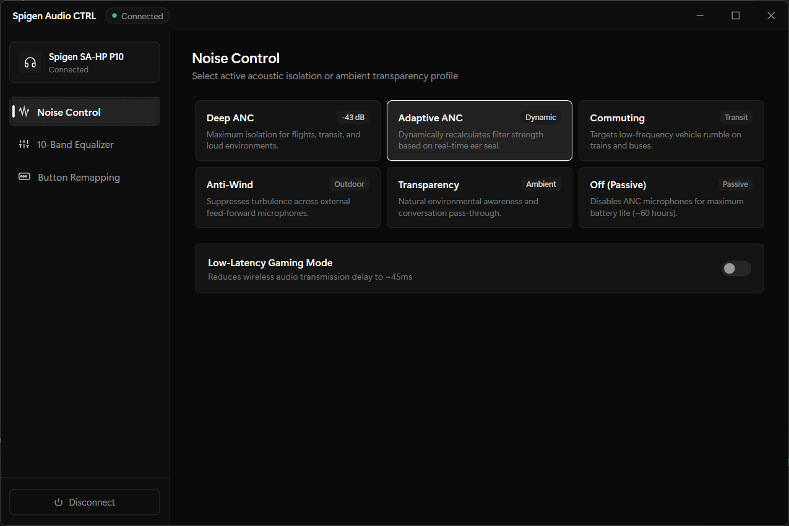
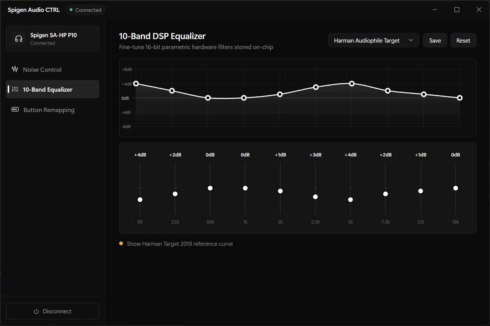
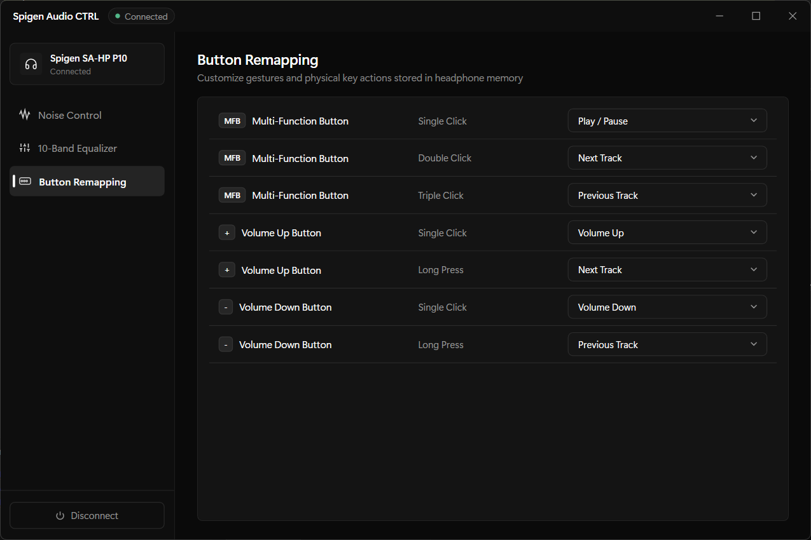

  # Spigen Audio CTRL

A native Linux desktop controller for the **Spigen SA-HP P10** headphones and **Spigen SA-TW P10** wireless earbuds. It uses GTK 4 and talks directly to BlueZ over D-Bus—no Wine, Electron, or Windows runtime is involved.

The connected model is detected automatically: the over-ear SA-HP P10 uses JL RCSP, while the SA-TW P10 earbuds use the QCY `A001` BLE protocol.

## Features

- Automatic profile detection for SA-HP P10 headphones and SA-TW P10 earbuds
- Six noise-control modes per model, with the earbud firmware reporting its current mode
- Low-latency Gaming Mode, including live state synchronization; the earbuds also expose Sleep Mode (touch lock)
- 10-band hardware EQ with ±8 dB controls, an editable response graph, Harman target overlay for the headphones, presets, and custom preset slots
- SA-HP P10: remap MFB single/double/triple click and volume-button single/long press
- SA-TW P10: remap left and right earbud single/double/triple touch gestures
- BLE discovery by device name or Spigen advertisement, GATT service discovery, notifications, clean disconnect, and automatic reconnect
- SA-HP P10: battery from BlueZ's standard Battery API and the RCSP response
- SA-TW P10: independent left, right, and charging-case battery levels from the Spigen LE advertisement and GATT characteristic `0008`
- Device name, firmware, gaming/sleep state, and onboard key-map parsing

All settings are sent to the device hardware. EQ and button assignments are stored on the device, not applied as a Linux audio effect.

## Screenshots

| Noise control | Equalizer | Button remapping |
|---|---|---|
|  |  |  |

## Arch Linux requirements

Install the runtime dependencies and enable Bluetooth:

```bash
sudo pacman -S --needed bluez bluez-utils gtk4 python python-cairo python-dbus python-gobject
sudo systemctl enable --now bluetooth.service
```

Pair the device once through your desktop Bluetooth settings or with `bluetoothctl`. The app can discover and connect to an already-known or nearby P10 device.

For the SA-TW P10, keep the earbuds in the charging case with the lid open while connecting. The earbuds expose a separate Bluetooth LE control address that is only advertised in that state; audio may still connect over classic Bluetooth while the control channel is unavailable.

## Run from the repository

```bash
./spigen-audio-ctrl
```

No Python virtual environment or downloaded PyPI package is required on Arch; all dependencies come from the official repositories.

## Install

```bash
make test
sudo make install
```

Then launch **Spigen Audio CTRL** from the desktop application menu or run `spigen-audio-ctrl`.

For an Arch package, push/tag the source as `v2.0.0`, then run:

```bash
makepkg -si
```

The included `PKGBUILD` builds from that release tag.

## Troubleshooting

- **No Bluetooth adapter found:** verify `systemctl status bluetooth` and `rfkill list bluetooth`.
- **Device not found:** turn it on, disconnect it from another controlling phone, and pair once with `bluetoothctl`.
- **SA-TW P10 control channel not found:** put both earbuds in the charging case and open the lid. Quit the Spigen phone app and disconnect the earbuds from any phone; the vendor app keeps the LE control link busy. Audio can be connected over classic Bluetooth while the LE control address is not advertising.
- **GATT services did not resolve:** reconnect the device, or remove and pair it again. BlueZ must expose the vendor BLE service in addition to the audio profile. For the earbuds, remove the stale LE entry from the phone if it still holds the control channel.
- **D-Bus access denied:** run the app as your normal desktop user, not with `sudo`; ensure your login session has normal BlueZ/Polkit access.
- Protocol and transport activity is printed to stdout when launched from a terminal.

## Development and tests

```bash
python3 -m pytest -q
python3 -m py_compile spigen_audio_ctrl/*.py
```

The protocol suite checks both RCSP and QCY frames: noise modes, gaming and sleep modes, key remapping, EQ binary layouts, battery parsing, advertisement parsing, and hardware-state TLVs. A real P10 is only required for end-to-end GATT verification.

## Architecture

| Path | Role |
|---|---|
| `spigen_audio_ctrl/app.py` | Native GTK 4 UI, feature state, and profile switching |
| `spigen_audio_ctrl/bluetooth.py` | BlueZ discovery, connection, profile detection, GATT I/O, notifications, reconnect |
| `spigen_audio_ctrl/protocol.py` | Platform-independent RCSP packet encoding and parsing |
| `spigen_audio_ctrl/qcy_protocol.py` | Platform-independent QCY/SA-TW P10 frame, EQ, battery, and advertisement codecs |
| `tests/test_protocol.py`, `tests/test_qcy_protocol.py` | Hardware-protocol regression tests |
| `packaging/io.github.spigen.AudioCTRL.desktop` | Desktop-menu entry |
| `Makefile`, `PKGBUILD` | Local and Arch Linux installation |

## Protocol

### SA-HP P10 (JL RCSP)

The headphones use proprietary RCSP frames over a vendor BLE GATT service:

```text
FE DC BA [flags] [opcode] [len_hi] [len_lo] [sequence] [payload...] EF
```

- Write characteristic: UUID `AE01` / `0001`
- Notify characteristic: UUID `AE02` / `0002`
- Standard battery service: UUID `180F`, characteristic `2A19`

### SA-TW P10 (QCY A001)

The earbuds use the QCY frame format over GATT service `A001`. One notification can contain several command TLVs:

```text
FF [body length] [command] [data length] [data...] [command] [data length] [data...] ...
```

| Characteristic | Purpose |
|---|---|
| `00001001` | Write control commands |
| `00001002` | Read/notify the settings snapshot |
| `00000008` | Read/notify left, right, and case battery (`bit 7` = charging) |
| `0000000B` | Read/write the 10-band EQ (`type` + ten signed dB values) |
| `0000000D` | Read/write raw `[event id, function id]` touch assignments |
| `00000007` | Read left/right firmware versions |

Commands used by the app include `9` (gaming), `12` (noise mode), `16` (sleep), and `FE 01 [command]` to request a setting. Command `7` is the vendor's ambient noise-level read and is deliberately not treated as the ANC mode. The earbuds are identified in LE advertisements by Spigen's company ID `21036`; the model/vendor ID is big-endian in the first two bytes (`19789` = SA-TW P10). The control link is strictly BLE GATT; SPP, OTA, and Wuqi/awota services are not used.

## Disclaimer and license

This is an independent, unofficial project and is not affiliated with Spigen Global Co., Ltd.

[MIT](LICENSE) — Copyright (c) 2026 Safan Sulfikar
